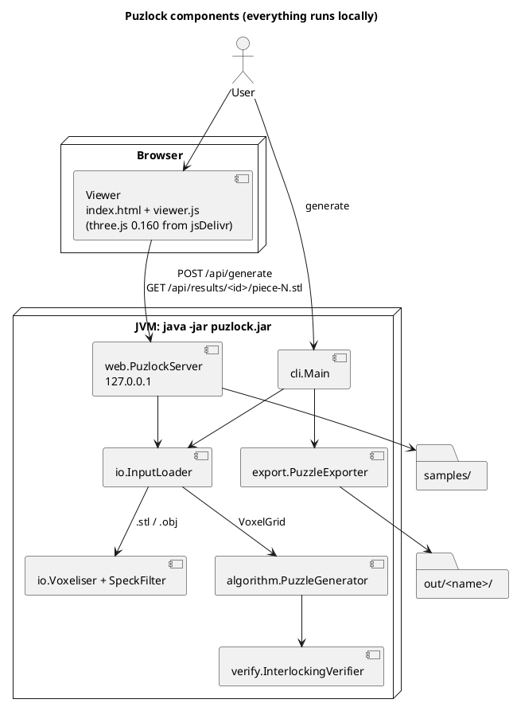
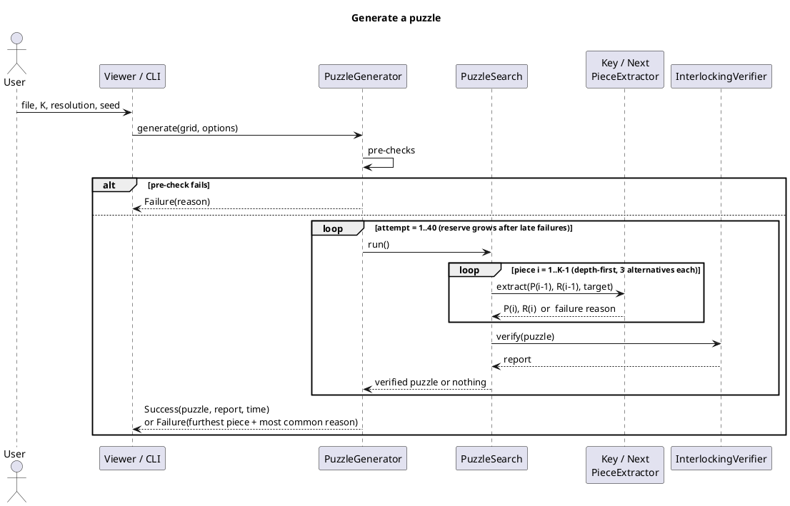
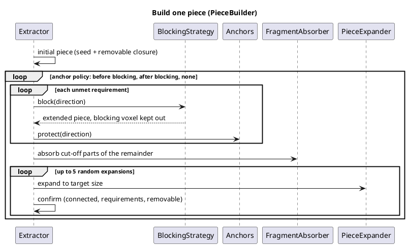

# Puzlock design

Puzlock takes a voxel grid, STL or OBJ file and splits the shape into K pieces that form a
**recursive interlocking puzzle** as defined by Song, Fu & Cohen-Or, *Recursive Interlocking
Puzzles* (ACM TOG 2012), §4–5: in every disassembly stage [Pᵢ, …, Pₙ, Rₙ] only Pᵢ can move,
and the key P1 slides out in exactly one direction. When it can't, it says why.

This completes the 2019 honours implementation (tag `honours-2019-submission`). The 2019 classes
were replaced rather than patched; how each limitation listed in the final paper (§5.3) was
resolved is in the table at the end.

## Components

| Package | Responsibility |
|---|---|
| `model` | `Direction` (6 axes, up = +y), `GridShape` (cell indexing), `VoxelGrid`, `Piece`, `Puzzle`, `Connectivity`. Voxel sets are `BitSet`s over grid indices. |
| `io` | `InputLoader` picks the reader: `GridFormat` (the 2019 renderer's text format), `StlReader` (binary + ASCII), `ObjReader`. Meshes go through `Voxeliser` and `SpeckFilter`. |
| `algorithm` | Song's method. `PuzzleGenerator` → `PuzzleSearch` → `KeyPieceExtractor` / `NextPieceExtractor` → `PieceBuilder` (`BlockingStrategy`, `Anchors`, `FragmentAbsorber`, `PieceExpander`) on top of `Accessibility`, `Mobility`, `PathFinder`, `RemovableClosure`. |
| `verify` | `InterlockingVerifier`: an independent check of the finished puzzle. |
| `export` | `PuzzleExporter`: `piece-N.grid`, `piece-N.stl` (10 mm voxels), `puzzle.json`. |
| `cli` | `Main`: `generate` and `serve`. |
| `web` | `PuzlockServer` (JDK `HttpServer`, 127.0.0.1 only) and the three.js viewer in `src/main/resources/web/`. |

## Input

- **Grid text**: one line per z slice, rows (y) separated by commas, one digit per x cell, `0` empty.
  Any size, any padding, any position. Ragged rows are reported with their line number.
- **STL / OBJ**: voxelised with `--resolution` cells along the longest side (default 16). A cell is
  solid when its centre is inside the mesh, decided by ray parity along all three axes with a
  majority vote. More than 10% leaking rays → "Mesh is not watertight". Voxels that touch the body
  only at an edge or corner are dropped when they are at most 2% of the total, with a note saying
  how many; real multi-part shapes are left alone and rejected by the generator.

## Algorithm

Notation follows Song: N voxels, K pieces, β = 3, Nb1 = 50, Nb2 = 10, accessibility weight 0.1
over 3 passes.

**Pre-checks** (reported immediately): no voxels; more than one connected part; K < 2; N/K < 3;
no key seed voxel.

**Key piece P1 (§5.1).** Seed = a voxel whose only exterior faces are the top and one side, both
with free passage. Requirements: blocked by the remainder in every direction except up.

**Next piece Pᵢ₊₁ (§5.2).** Seeds touch Pᵢ across a face perpendicular to dᵢ; dᵢ₊₁ points from the
seed into Pᵢ. Ten seeds are shortlisted by rank of accessibility plus voxels ahead along dᵢ₊₁; the
initial piece is the seed made removable along dᵢ₊₁. Requirements, in all six directions:
(a) Pᵢ₊₁ blocked by Pᵢ ∪ Rᵢ₊₁, and (b) Pᵢ ∪ Pᵢ₊₁ blocked by Rᵢ₊₁ (cannot co-move). These are
exactly the conditions Song's appendix uses to prove global recursive interlocking.

**Building a piece (`PieceBuilder`).**
1. `BlockingStrategy` meets each unmet requirement: nearest Nb1 blockee/blocking pairs along that
   direction, keep the Nb2 lowest-accessibility blockees, extend by a shortest path that avoids the
   blocking voxel and everything behind it, apply the removable closure, keep the cheapest.
2. `Anchors` protect blockage already built (Song's anchor voxels): the furthest directly-connected
   remaining voxel along the blocked direction, plus everything behind it, is kept out.
3. `FragmentAbsorber` takes any parts the blocking paths cut off the remainder into the piece.
4. `PieceExpander` grows the piece to its target size, picking neighbours with probability
   ∝ (accessibility sum)^-β, rejecting any pick that splits the remainder or undoes blockage.
5. Confirm: piece and remainder connected, all requirements met, removable along its direction.

`RemovableClosure` is Song's "add every voxel above the path", generalised to any move direction:
every remaining voxel in front of the piece joins it and detached parts are reconnected.
`PathFinder` searches are bounded by the room the piece has left, which prunes exactly and keeps
work local (the effect of Song's bounding-box localisation).

**Search.** One attempt is a depth-first search: if piece i cannot be built, piece i−1 is
re-extracted with fresh random choices (3 alternatives per piece, 25·K extractions per attempt).
Each piece aims for an equal share of what is left. When an attempt fails within the last three
pieces, later attempts give the last piece up to 3 extra shares of room (fewer when K is small):
the last piece must wrap around the two before it, which a piece of only m voxels rarely can when
m is small. Default 40 attempts; the first puzzle that passes the verifier is returned.

## Verifier

Independent of the generator (it shares only `model`). For a puzzle P1 … Pₙ, Rₙ it checks:
1. the pieces partition the input exactly and each is connected;
2. at every stage i, Pᵢ can slide fully out along dᵢ, and the key P1 cannot move any other way;
3. no other group of pieces can move in any direction: exhaustively over all subsets when a stage
   has at most 16 pieces (bitmask contact tables), otherwise Song's local conditions (a) and (b)
   for every consecutive pair, which their appendix proves sufficient.

## Viewer

`java -jar target/puzlock.jar serve [--port 8080]`, then open `http://localhost:8080`. Pick a
sample or upload a file, set pieces / resolution / seed, Generate. Pieces use Song's colours (red
key, blue, yellow, orange, …, green last piece). Orbit and zoom with the mouse; Explode spreads the
pieces; Remove / Put back steps through the disassembly (removed pieces slide out along their
direction and fade); the list shows sizes, directions, show/hide and STL / grid downloads. A
failure shows the reason in red and the loaded voxels in grey. Works at phone width and follows
the system light/dark theme.

## The 2019 limitations, resolved

| 2019 final paper §5.3 | Now |
|---|---|
| Anchor voxels added to the key; set before the removable piece | Anchors are computed after blocking and are never part of the piece |
| One anchor only; needs one per blocked direction | One per blocked direction and per blocking pair |
| Key expansion ran once, not until ~m voxels | Expansion loops to the target size |
| Order of §5.1.3/5.1.4 wrong; `anchorVoxel2` misplaced | Song's order |
| Secondary pieces (§5.2.3–5.2.4) not built; key hard-coded | Full iterative extraction of every piece |
| Only 1s packed at the top-left; 0-padding broke it | Any grid, padded, off-centre, non-cubic |
| Only 4×4×4 tested; 15³/25³ hit `StackOverflowError` | Iterative searches; see `docs/results.md` |
| Only the renderer's grid format | Grid, STL and OBJ, with its own voxeliser |
| No way to check the output interlocks | Independent verifier on every result |
| Could not manipulate the visualisation | Interactive viewer |

## Where this differs from Song et al.

- Expansion and confirmation test blockage explicitly instead of relying only on anchors; anchors
  are still used first, with two fallback orders when their kept-out zones leave no room.
- Cut-off parts of the remainder are absorbed into the piece instead of discarding the piece.
- Backtracking and the late-piece size reserve (Song's paper describes neither; without them
  4×4×4 into 8 pieces never succeeded in testing).
- Piece sizes are "roughly m": each aims for a share of what is left, blocking may overshoot by
  50%, and the last piece may be larger.
- No bounding-box localisation; depth-bounded searches play that role.
